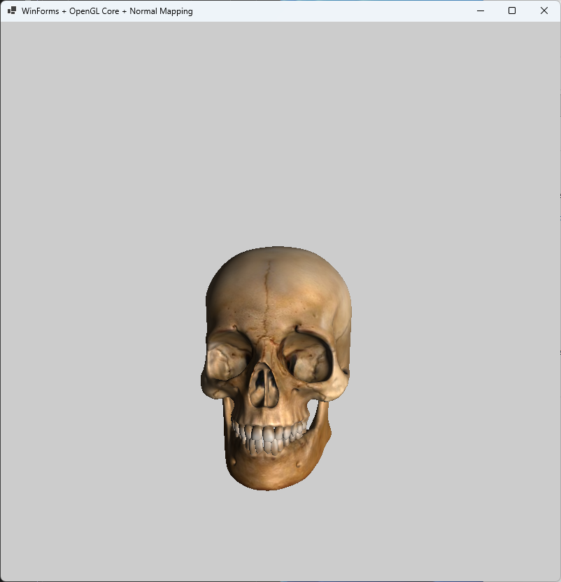

# OpenGL 4 Skull Renderer - Effects Version

This is a small C# / WinForms renderer using OpenGL directly through Win32 / WGL interop. It does not use OpenTK, SharpGL, Silk.NET, GLFW, SDL, ImGui, or any other external graphics library.

This version extends the original textured OBJ viewer with a more visual shader pipeline and a small scene around the model.

## Added effects

- Tangent-space normal mapping generated at runtime from the diffuse texture
- Fresnel-based reflective material effect
- Procedural environment reflection in the fragment shader
- Stronger specular highlights
- Cyan rim lighting on silhouettes
- Animated scanning energy bands across the model
- Reflective mirror-floor pass using a second mirrored draw of the model
- Procedural glowing grid floor
- Darker cinematic background
- Keyboard toggles for comparing the original and enhanced look

This is not hardware ray tracing. It is still classic rasterization, but the shader uses reflection vectors, Fresnel weighting, procedural environment lighting, and a mirrored render pass to create a more advanced visual result while keeping the project compact.

## Screenshot

## Controls

- Left mouse drag — rotate camera/model
- Mouse wheel — zoom
- Space — toggle auto-rotation
- E — toggle shader effects
- M — toggle mirror floor / reflection pass
- R — reset camera
- Esc — close

## Technical Details

- Language: C#
- UI: WinForms
- Graphics API: OpenGL 4 Core Profile
- Interop: Win32 / WGL / GDI through P/Invoke
- Model format: Wavefront OBJ
- Texture loading: System.Drawing
- No third-party libraries

## How to Run

Open the solution in Visual Studio and build/run the WinForms project. x64 is recommended.

The project expects these files to be copied to the output directory:

- `objects/skull.obj`
- `objects/skull.jpg`
- `shaders/skull.vert`
- `shaders/skull.frag`

The `.csproj` already contains `CopyToOutputDirectory` entries for them.

## Support

If you found this project interesting or useful, you can support my work:

